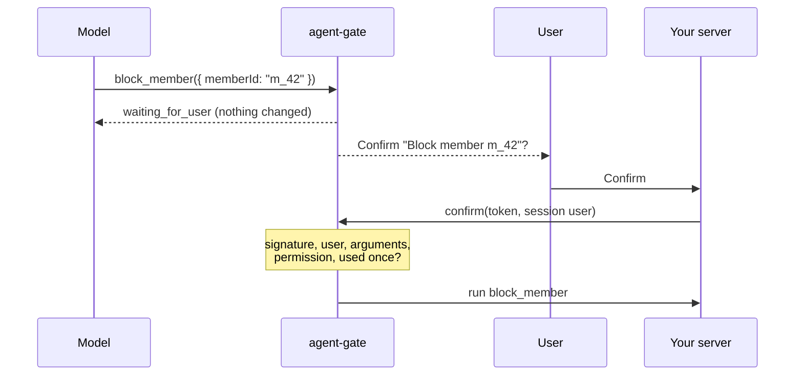

# agent-gate

[](https://github.com/tawachdev/agent-gate/actions/workflows/ci.yml)
[](https://www.npmjs.com/package/agent-gate)
[](LICENSE)

Your AI agent can read anything you allow. It can change nothing until a human says yes.



**At a glance**

| | Read tool | Write tool |
|---|---|---|
| Runs when the model calls it | Yes | No. It returns a pending action |
| Needs the user to confirm | No | Yes |
| Checked again on confirm | | Signature, user, arguments, permission |
| Can run twice from one confirm | | No. A token works once |
| Works with | OpenAI, Anthropic, Gemini | OpenAI, Anthropic, Gemini |

## Quick start

Needs: Node.js 22 or newer, and Zod 4.2 or newer.

```bash
npm install agent-gate zod
```

**1. Describe your tools.** Mark each one `read` or `write`.

```ts
import * as z from "zod";
import { createGate, defineTool, forModel } from "agent-gate";

const blockMember = defineTool({
  name: "block_member",
  kind: "write",
  description: "Block one member so they cannot book",
  input: z.object({ memberId: z.string().min(1) }),
  authorize: (input, ctx) => canManageMembers(ctx.actorId),
  describe: (input) => ({ action: "Block member", target: input.memberId, danger: true }),
  run: (input, ctx, action) => db.members.block(input.memberId, { requestId: action.id }),
});

const secret = process.env.AGENT_GATE_SECRET;
if (!secret) throw new Error("AGENT_GATE_SECRET is missing");
const gate = createGate({ tools: [blockMember], secret });
```

**2. Send every tool call from the model through the gate.**

```ts
const result = await gate.handle({ name: call.name, args: call.args }, { actorId: session.userId });
sendToModel(forModel(result));
if (result.status === "pending") showConfirmDialog(result.summary, result.token);
```

**3. When the user presses Confirm, run it on your server.**

```ts
const confirmed = await gate.confirm(tokenFromClient, { actorId: session.userId });
```

`canManageMembers`, `db`, `call`, `session`, `sendToModel` and `showConfirmDialog` are your own code.

## Proof

Output of `npm run example` ([examples/basic.ts](examples/basic.ts)):

```text
read  -> {"status":"done","output":{"id":"m_42","name":"Ahmed","blocked":false}}
write -> {"status":"waiting_for_user","action":"Block member","target":"m_42","note":"Nothing has changed yet. The user must confirm this action. Do not say it is done."}
blocked after proposal: []
stranger confirm -> {"status":"rejected","tool":"block_member","reason":"wrong_actor"}
owner confirm    -> {"status":"done","tool":"block_member","output":{"blocked":"m_42"}}
owner again      -> {"status":"rejected","tool":"block_member","reason":"already_used"}
blocked at the end: [ 'm_42' ]
```

The member is blocked only after the owner confirms, and only once.

## API

| Function | What it does |
|---|---|
| `defineTool(tool)` | Declares a tool. `kind: "read"` runs right away. `kind: "write"` needs `authorize`, `describe` and `run` |
| `createGate(options)` | Builds the gate and keeps its own copy of the tool list. Throws right away on a bad secret, tool name or `ttlSeconds` |
| `gate.handle(call, ctx)` | Read tool: parses, authorizes, runs. Write tool: parses, authorizes, returns `pending` with `actionId`, `token` and `summary` |
| `gate.confirm(token, ctx)` | Takes the token exactly as the client sent it, of any type. Checks type and size, signature and expiry, checks `ctx.actorId`, parses the original arguments again, authorizes again, marks the token used, then calls `run(input, ctx, action)` |
| `gate.cancel(token, ctx)` | Checks the token and the user, then marks the token used so it can never be confirmed |
| `forModel(result)` | The result for the model, without the token. A pending action tells the model nothing changed yet |
| `anthropicTools`, `openaiChatTools`, `openaiResponsesTools`, `geminiTools` | Your tools in the shape each provider expects |

## Results

Every call returns a plain object with a `status`: `done`, `pending`, `cancelled` or `rejected`.

| `reason` when rejected | When |
|---|---|
| `unknown_tool` | The model called a tool you did not register, or the token names a tool this gate does not have |
| `invalid_input` | The arguments do not match the Zod schema, or are too large for a token (64 KB). `issues` says what is wrong |
| `forbidden` | `authorize` returned false, at proposal or at confirm |
| `invalid_token` | Not a string, over 64 KB, not signed by this gate, or changed |
| `expired` | Older than `ttlSeconds` |
| `wrong_actor` | Made for another user. It stays usable for its real user |
| `already_used` | Confirmed or cancelled before |

## Use it with your model

| Provider | Pass this as the tools | Read the call from |
|---|---|---|
| Anthropic Messages | `anthropicTools(tools)` | `content` block with `type: "tool_use"`: `name`, `input` |
| OpenAI Chat Completions | `openaiChatTools(tools)` | `message.tool_calls[i].function`: `name`, `JSON.parse(arguments)` |
| OpenAI Responses | `openaiResponsesTools(tools)` | `output` item with `type: "function_call"`: `name`, `JSON.parse(arguments)` |
| Gemini | `{ functionDeclarations: geminiTools(tools) }` | `response.functionCalls[i]`: `name`, `args` |

The output of each function is checked at compile time against the official SDK types (`@anthropic-ai/sdk` 1.3.0, `openai` 7.45.0, `@google/genai` 2.31.0) in [test/providers.test-d.ts](test/providers.test-d.ts). OpenAI tools are sent with `strict: false`, because strict mode needs every property to be required.

## Options

| Option | Default | Meaning |
|---|---|---|
| `tools` | required | Names must match `^[a-zA-Z0-9_-]{1,64}$` and be unique. Inputs must be `z.object(...)` |
| `secret` | required | At least 32 bytes. Keep it in an environment variable |
| `ttlSeconds` | `300` | How long a pending action can wait. 10 to 86400 |
| `replayStore` | in memory | Where used token ids are kept. Use a shared store with more than one server |

## Before production

| Check | Why |
|---|---|
| Secret from the environment, 32 bytes or more | A short or leaked secret lets anyone mint actions |
| `authorize` checks the record belongs to `ctx` | The token is bound to a user, not to a workspace |
| Shared replay store when you run 2+ servers | The in-memory store cannot see other servers |
| `action.id` used as the idempotency key in `run` | A crash after a payment call must not charge twice |
| No secrets in tool arguments | The token is signed, not encrypted |

## Running more than one server

The default store lives in one process. Give the gate a store backed by your database. The primary key makes the claim safe when two confirms race:

```sql
create table agent_gate_used_tokens (
  token_id text primary key,
  expires_at timestamptz not null
);
```

```ts
const replayStore = {
  async claim(tokenId: string, expiresAt: Date) {
    const result = await pool.query(
      "insert into agent_gate_used_tokens (token_id, expires_at) values ($1, $2) on conflict do nothing",
      [tokenId, expiresAt],
    );
    return result.rowCount === 1;
  },
};
```

This Postgres store is an example. The tests cover the in-memory store only. Delete rows past `expires_at` on a schedule.

## Design choices

| Choice | Why | The other option |
|---|---|---|
| The pending action lives in a signed token | No database table is needed to start | Store the pending action in your database and hand out only its id. Better if arguments are large or private |
| The token is spent before `run` | A half-finished write is never run twice by accident | Spend it after `run`. Then a crash can lead to a double run |
| One secret, no key ids yet | Simple. A pending action lives 5 minutes by default | Key rotation with `kid`. Planned. Today, changing the secret cancels pending actions |

## What leaves your server

Nothing. agent-gate makes no network calls. The token goes to your client and comes back. The model gets only what `forModel` returns.

## Security

See [SECURITY.md](SECURITY.md) for what is protected, what is not, the test behind each rule, and how to report a problem.

## Development

| Command | What it runs |
|---|---|
| `npm run check` | Type check, 39 tests, build |
| `npm run example` | Build, then [examples/basic.ts](examples/basic.ts) |
| `npm run test:live` | Real calls to Anthropic, OpenAI and Gemini. Each part runs only when its key is set: `ANTHROPIC_API_KEY`, `OPENAI_API_KEY` with `OPENAI_MODEL`, `GEMINI_API_KEY` |

CI runs the check on Node.js 22, 24 and 26, and again with Zod 4.2.0, the oldest supported version. The live tests run in CI only when started by hand.

## License

MIT. See [LICENSE](LICENSE).
